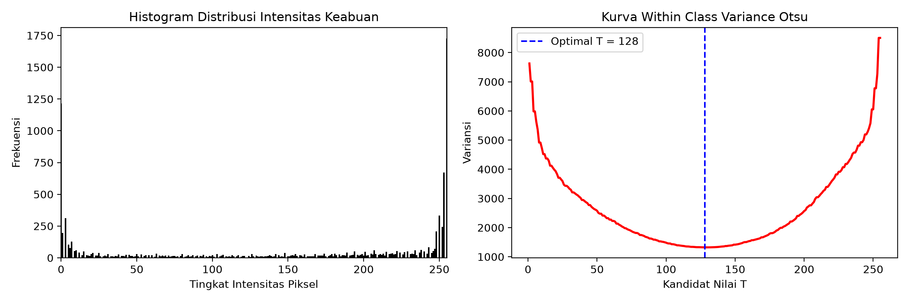
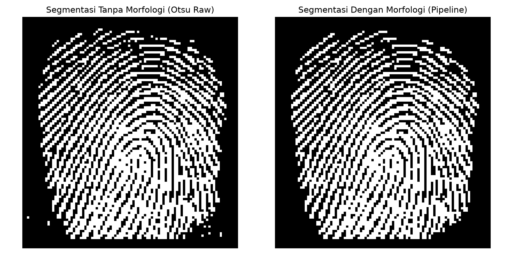
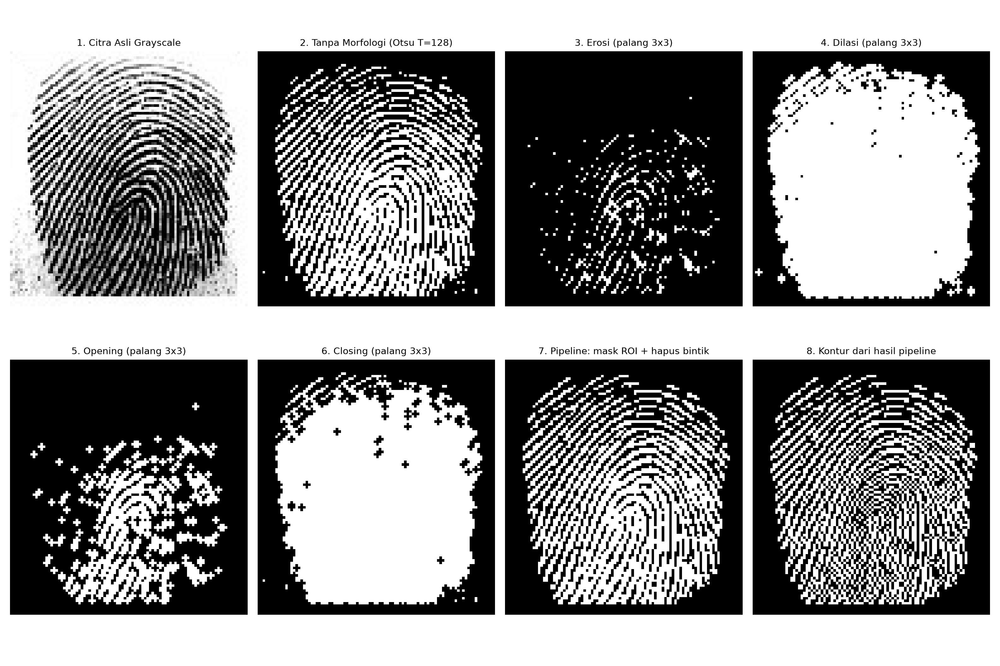

# PCD Assignment 03: Image Segmentation and Morphological Processing

* **Nama:** Muhammad Gauza Faliha
* **NIM:** 25/555851/PA/23315
* **Prodi:** Ilmu Komputer
* **Mata Kuliah:** Pengolahan Citra Digital

Di repositori ini saya mengimplementasikan segmentasi Otsu Thresholding dan operasi morfologi (erosi, dilasi, opening, closing) dari nol tanpa library pengolahan citra pada citra sidik jari, lalu membandingkan hasil segmentasi sebelum dan sesudah morfologi.

File: `PCD_Assignment03.ipynb` (notebook), `100__M_Left_index_finger.bmp` (citra), dan tiga gambar hasil (PNG).

## Alur Pengerjaan

1. **Input citra**: membaca citra sidik jari dan mengubahnya ke grayscale. Bingkai abu-abu 2 piksel di sisi atas dan kiri saya buang karena bukan bagian sidik jari.
2. **Histogram**: menghitung frekuensi intensitas 0 sampai 255 untuk masukan Otsu.
3. **Otsu**: mencari T dengan within class variance terendah, hasilnya T = 128.
4. **Binerisasi**: nilai dibalik supaya alur sidik jari bernilai 1 dan latar bernilai 0.
5. **Morfologi**: erosi, dilasi, opening, closing, dan kontur, semuanya dibuat dari nol.
6. **Evaluasi**: menghitung komponen terhubung dengan BFS dari nol.

## Hasil

### Histogram dan nilai T Otsu

### Sebelum dan sesudah morfologi

### Semua operasi morfologi

## Evaluasi

Rasio ROI adalah persentase piksel alur di dalam area sidik jari. Kalau angkanya naik jauh dari citra mentah, berarti celah antar alur ikut tertutup.

| Tahap | Komponen (CC-8) | Bintik kecil (<6 px) | Rasio ROI |
| :--- | :--- | :--- | :--- |
| Otsu mentah | 43 | 23 | 57.0% |
| Closing palang 3x3 | 16 | 15 | 89.0% |
| Opening palang 3x3 | 39 | 18 | 26.9% |
| Pipeline mask ROI + hapus bintik | 20 | 0 | 56.4% |

## Penjelasan Singkat

Awalnya saya memakai closing palang 3x3 sebagai hasil akhir. Ternyata hasilnya mengisi seluruh area sidik jari menjadi blok putih, karena celah antar alur cuma sekitar 2 piksel. Jumlah komponennya memang turun, tapi itu karena alur-alurnya menyatu, bukan karena tersambung dengan benar (rasio ROI naik dari 57% jadi 89%). Opening 3x3 juga membuang lebih dari separuh piksel alur.

Karena itu pipeline akhir yang saya pakai:
1. Closing lalu opening dengan kotak 7x7 untuk membentuk mask area sidik jari.
2. Mask di-AND dengan citra biner mentah.
3. Komponen di bawah 6 piksel dihapus.

Hasilnya bintik di latar hilang (23 jadi 0) dan alur tetap utuh (rasio ROI 57.0% jadi 56.4%).

## Kesimpulan

1. Otsu bisa memisahkan alur dari latar secara otomatis, tapi hasil mentahnya masih punya alur putus, pori, dan bintik latar.
2. Operator tunggal 3x3 kurang cocok untuk citra sekecil ini (96 x 103 piksel) karena alurnya hanya setebal 2 sampai 3 piksel.
3. Morfologi lebih berguna untuk membentuk mask area sidik jari daripada mengubah alurnya langsung.
4. Keterbatasan: alur putus di dalam sidik jari belum tersambung, dan bagian bawah yang gelap masih menyatu karena threshold-nya global. Bisa dicoba Otsu per blok.
